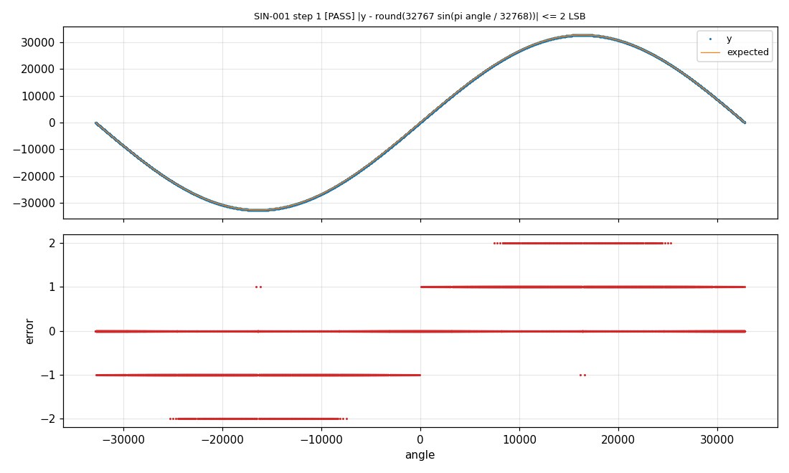

# 1. Getting started with e2Unit

**English** | [Français](../tutoriels/01-prise-en-main.md)

Run the example tests on the PC and read their results. This tutorial assumes e2Unit is installed
and `eunit.local.mk` is filled in (see the [contents](README.md)).

## Running a suite

A **suite** groups the tests of one function (or several). The suite of `emath_sin` is in
[`examples/emath/tests/sin`](../../examples/emath/tests/sin):

```
cd examples/emath
make test/sin
```

```
eunit: generated build\gen\eunit_suite.c
eunit: generated build\gen\suite.mk
eunit: building build/host/sin.dll
e2Unit 0.1.0: suite sin, 3 test(s) on host
eunit: Personal License - Non-commercial use only
  [PASS ] SIN-001 accuracy over the full turn (65536 samples, 0.01 s)
  [PASS ] SIN-002 exact values on the axes (4 samples, 0.00 s)
  [PASS ] SIN-003 odd symmetry and range (65535 samples, 0.01 s)
eunit: PASS - 3 passed, 0 failed, 0 errors, 0 skipped in 0.02 s - reports in build\report\host
```

In three lines, make has:

1. **generated** the C interface code (`eunit_suite.c`) from the `sin.yaml` specification;
2. **built** a PC library (`sin.dll`) with `emath_sin.c` and the e2Unit runtime;
3. **run** the three tests: 131,075 calls of `emath_sin` in 20 ms.

The `eunit: Personal License ...` line recalls the license in use. On the very first run, a window
asks to choose it (see the [contents](README.md)).

`make test` without argument runs every suite of the example. `make -k test` keeps going after a failure.

## Reading the details

Each test holds one or more **checks**. The `-v` option prints them all:

```
cd tests/sin
make EUNIT_RUN_OPTS=-v
```

```
  [PASS ] SIN-001 accuracy over the full turn (65536 samples, 0.01 s)
         1. [PASS] |y - round(32767 sin(pi angle / 32768))| <= 2 LSB: 65536 samples, max |err| 2 (tol abs=2)
         2. [SKIP] execution time: no cycle counter on this runner
```

- Check 1 compares every output with the ideal sine: the maximum error is 2 LSB, and so is the
  tolerance. The test passes, with no margin.
- Check 2 is about execution time: it only makes sense on the board (tutorial
  [6](06-ra4e1-jlink.md)). On the PC it is **SKIP**, not a failure.

The possible verdicts:

| Verdict | Meaning |
|---|---|
| PASS | all checks pass |
| FAIL | at least one check fails: the function does not meet its specification |
| ERROR | the test could not run: invalid specification, stimulus out of the C type, stuck function, CPU fault |
| SKIP | nothing could be checked on this runner (cycles on the PC) |

The exit code follows the verdict: 0 when everything passes, 1 on a failure, 2 on an error. A
continuous integration server therefore stops on a wrong test.

## Reports

Each run writes into `build/report/<runner>/`:

| File | Content |
|---|---|
| `junit.xml` | JUnit format, read by Jenkins, GitLab CI, etc. |
| `results.json` | all results and statistics, for other tools |
| `<suite>_host.xlsx` | Excel report: a summary sheet, and a sheet with one row per check (requirement, test, result) |

The *Tests* Excel sheet is the traceability matrix: the *Requirement* column repeats the
requirement declared in the specification (`EMATH-SIN-01`...).

## Plots

`--plot` saves one PNG per failed check; `--plot-all` saves them all:

```
make EUNIT_RUN_OPTS="--plot build/plots --plot-all"
```

At the top, the output and the expected value; at the bottom, the error. For `emath_sin`, the
error stays within ±2 LSB over the whole turn:



## What a suite contains

```
tests/sin/
  sin.yaml     the specification: sources, function, tests
  Makefile     3 lines
  build/       generated: code, library, firmware, reports
```

The Makefile is the same for every suite, except for the file name:

```make
EUNIT_ROOT := ../../../..
SUITE      := sin.yaml
include $(EUNIT_ROOT)/mk/eunit.mk
```

`make list` prints the functions and tests of a suite, `make clean` deletes `build/`.
[Tutorial 2](02-testing-a-function.md) writes a complete suite.

## Troubleshooting

| Symptom | Likely cause |
|---|---|
| `gcc: not found` or `cc1.exe` does not start | wrong `HOST_CC` path, or MSYS2 `bin` folder missing from `PATH` in `eunit.local.mk` |
| `PyYAML is required` | `pip install pyyaml` in the Python set by `PY` |
| `cannot load ...dll` | 32-bit Python with a 64-bit gcc (or the reverse): both must be 64-bit |
| `... does not match suite ...: rebuild it` | library built from another version of the specification: `make clean`, then `make` |
