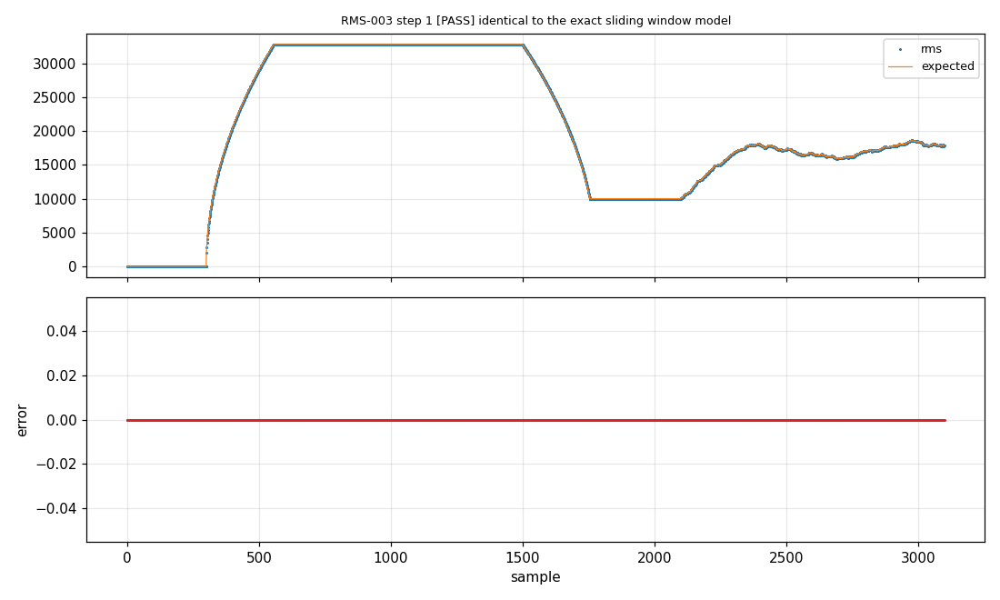

# 4. Stateful functions

**English** | [Français](../tutoriels/04-fonctions-a-etat.md)

Test a function that keeps a state between two calls: a sliding RMS. The prototype is no longer
enough, so we write a small **adapter** in C.

## The function

[`emath_rms.c`](../../examples/emath/src/emath_rms.c) computes the RMS value of the last 2ⁿ
samples. The context (window, sum of squares) is passed by pointer:

```c
bool     emath_rms_init(emath_rms_t *ctx, uint8_t log2n);   /* false if log2n > 8 */
uint16_t emath_rms_update(emath_rms_t *ctx, int16_t x);     /* adds x, returns the RMS */
```

A pointer cannot be generated: which context should be passed, and where should it live between
two calls? That is the adapter's job.

## 1. The adapter

An adapter receives the inputs and returns the outputs as 32-bit words. It is written with the
`EUNIT_ADAPTER(name)` macro in
[`rms_adapter.c`](../../examples/emath/tests/rms/rms_adapter.c):

```c
#include "eunit.h"
#include "emath.h"

static emath_rms_t rms_ctx;   /* the context lives here, between calls */

EUNIT_ADAPTER(rms_init)
{
    out[0] = emath_rms_init(&rms_ctx, (uint8_t)in[0]) ? 1 : 0;
}

EUNIT_ADAPTER(rms_update)
{
    out[0] = (int32_t)emath_rms_update(&rms_ctx, (int16_t)in[0]);
}
```

## 2. The specification

The file is added to the sources. Under `functions`, `custom: true` tells e2Unit not to generate
the adapter. The prototype now only describes the interface seen by the tests:

```yaml
build:
  sources: [../../src/emath_rms.c, ../../src/emath_isqrt.c, rms_adapter.c]
  includes: [../../src]
  headers: [emath.h]

models: [../emath_ref.py]

functions:
  rms_init:
    prototype: "bool rms_init(uint8_t log2n)"
    custom: true
    returns: ok
  rms_update:
    prototype: "uint16_t rms_update(int16_t x)"
    custom: true
    returns: rms
```

An adapter can also return several values: `outputs: "uint32_t acc, int16_t last"` declares
extra outputs, written into `out[1]`, `out[2]`...

## 3. Setup and reset

```yaml
  - id: RMS-003
    title: transients and full scale, 256 samples window
    requirement: [EMATH-RMS-02, EMATH-RMS-03]
    setup:
      - rms_init: [8]                 # window of 2^8 = 256 samples
    call: rms_update
    stimuli:
      x:
        segments:
          - {n: 300, dc: 0}
          - {n: 600, dc: -32768}
          - {n: 600, dc: 32767}
          - {n: 600, square: {amp: 10000, period: 50}}
          - {n: 1000, noise: 30000}
    checks:
      - desc: identical to the exact sliding window model
        expect: rms_window(x, 8)
      - desc: full scale negative input gives 32768 (no overflow)
        window: [556, 900]
        expect: 32768
      - desc: never above full scale
        max: 32768
```

- **Reset.** Before each test, e2Unit puts the code back in its start-up state: the PC library is
  reloaded, the board is reset. `rms_ctx` and every static variable start from zero again, and the
  order of the tests does not matter. `reset: false`, on the contrary, continues from the state
  left by the previous test.
- **Setup.** `setup:` calls functions before the stimuli, here the initialisation.
- The 3100 samples are then passed **in order** to `rms_update`.

## 4. The model

The exact reference of a sliding RMS takes a few lines of numpy, in
[`emath_ref.py`](../../examples/emath/tests/emath_ref.py):

```python
def rms_window(x, log2n):
    """floor(sqrt(mean of the squares of the last 2^log2n samples)), zeros before start."""
    n = 1 << int(log2n)
    sq = np.asarray(x, dtype=np.int64) ** 2
    csum = np.concatenate(([0], np.cumsum(sq)))
    i = np.arange(len(sq))
    window = csum[i + 1] - csum[np.maximum(i + 1 - n, 0)]
    return np.array([math.isqrt(int(v) >> int(log2n)) for v in window], dtype=np.int64)
```

The model computes the window with cumulative sums, the C code with a circular buffer: two
different methods that must give exactly the same result.

## 5. Result

```
  [PASS ] RMS-003 transients and full scale, 256 samples window (3100 samples, 0.01 s)
         1. [PASS] identical to the exact sliding window model: 3100 samples, max |err| 0 (tol exact)
         2. [PASS] full scale negative input gives 32768 (no overflow): 344 samples, max |err| 0 (tol exact)
         3. [PASS] never above full scale: 3100 samples within bounds, observed [0, 32768]
```

For a signal, the x axis of the plots is the sample index:



It shows the rise over 256 samples, the plateau at 32768 (negative full scale, no overflow), the
fall to 10000 on the square wave, then the noise.

## Testing a `static` function

A `static` function is not visible from another file. The adapter can include the source file itself:

```c
#include "eunit.h"
#include "module.c"      /* gives access to static functions and variables */

EUNIT_ADAPTER(filter_step) { out[0] = filter_step((int16_t)in[0]); }
```

In that case, `module.c` must not also be listed in `build: sources:`.

[Tutorial 5](05-target-without-board.md) builds these same suites for the microcontroller.
