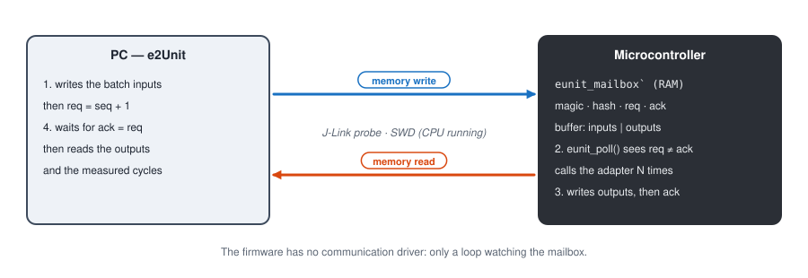

# 5. On target, without a board

**English** | [Français](../tutoriels/05-cible-sans-carte.md)

Build a suite for the microcontroller, then run the **real ARM binary** in a Cortex-M emulator,
compared bit for bit with the PC. No hardware is needed.

Testing on the PC is not enough: the target has another compiler, other options, and not
necessarily the same size of `int`. An overflow, a division or a sign extension can give another
result. e2Unit runs the same specification on both and compares.

## 1. The test firmware

```
cd examples/emath/tests/mulq15
make target
```

```
eunit: building build/ra4e1/mulq15.elf for ra4e1
   text	   data	    bss	    dec	    hex	filename
    972	      0	  32852	  33824	   8420	build/ra4e1/mulq15.elf
```

The firmware contains:

| Part | File | Role |
|---|---|---|
| minimal start-up | [`eunit_startup.c`](../../target/port/cortex-m/eunit_startup.c) | vectors, `.data` copy, FPU, HardFault capture |
| runtime | [`eunit_runtime.c`](../../target/src/eunit_runtime.c) | batch execution, mailbox loop |
| port | [`eunit_port_cortexm.c`](../../target/port/cortex-m/eunit_port_cortexm.c) | cycle counter (DWT, or SysTick on M0/M23) |
| adapters | `build/gen/eunit_suite.c` | generated, the same as on the PC |
| your code | `emath_mul.c` | built by arm-none-eabi-gcc |

Less than 1 KB of code. The 32 KB of `.bss` are the exchange buffer (8192 words, set in the board
description). No interrupt, no peripheral: the firmware runs on the reset clock.

The board is described in [`boards/ra4e1/board.mk`](../../boards/ra4e1/board.mk):

```make
BOARD_CPU_FLAGS := -mcpu=cortex-m33 -mthumb -mfloat-abi=hard -mfpu=fpv5-sp-d16
BOARD_LDSCRIPT  := $(EUNIT_ROOT)/boards/ra4e1/ra4e1.ld
BOARD_DEFS      := -DEUNIT_BUF_WORDS=8192u -DEUNIT_CPU_HZ=0u
JLINK_DEVICE    := R7FA4E10D
BOARD_EMU_CPU   := cortex-m33
```

## 2. The principle: a mailbox in RAM



The firmware has no communication driver. It reserves a structure in RAM, `eunit_mailbox`, and
watches it in a loop:

1. the PC writes the inputs of a batch (thousands of calls) into the buffer, then increments `req`;
2. the firmware sees `req ≠ ack`, calls the adapter for each set of inputs and measures the cycles;
3. it writes the outputs, then `ack = req`;
4. the PC reads the outputs back.

The mailbox address is read from the `.elf`. A **hash** of the specification, built into the
firmware, guarantees that the binary matches the tests: otherwise e2Unit refuses to run (`rebuild it`).

## 3. Running in the emulator

```
make test-emu EUNIT_RUN_OPTS=-v
```

```
e2Unit 0.1.0: suite mulq15, 2 test(s) on emu (compared with host)
eunit: Personal License - Non-commercial use only
  [PASS ] MUL-001 accuracy on a 257 x 257 grid (66049 samples, 0.28 s)
         1. [PASS] |p - a b / 32768| <= 0.5 LSB, saturated to int16: 66049 samples, max |err| 0.5 (tol abs=0.5)
         2. [PASS] p identical to host: 66049 samples identical
  [PASS ] MUL-002 remarkable values (6 samples, 0.02 s)
         1. [PASS] 0.5 x 0.5, -0.5 x 0.5, max x max, -1 x max, -1 x -1 (saturated), 0 x -1: 6 samples, max |err| 0 (tol exact)
         2. [PASS] p identical to host: 6 samples identical
eunit: PASS - 2 passed, 0 failed, 0 errors, 0 skipped in 0.31 s - reports in build\report\emu-ra4e1
```

The `emu` runner loads the `.elf` into **Unicorn**, an ARM instruction set emulator, starts at the
reset vector and talks to the mailbox exactly as the probe will. Each test gets one more check,
**`p identical to host`**: the same suite runs on the PC library, and every target output is
compared bit for bit.

The emulator executes the instructions but does not count cycles: `cycles` checks stay SKIP.

## 4. Faults and hangs

On the target, a function can crash or never return. e2Unit reports it on the test concerned, then
resets the target for the following tests:

| Situation | Verdict | Message |
|---|---|---|
| invalid memory access, HardFault | ERROR | `CPU fault at PC 0x...` |
| infinite loop | ERROR | `no answer within ... s (function stuck in an infinite loop?)` |
| firmware missing or stopped | ERROR | `e2Unit runtime not ready (no magic at 0x...)` |

On the board, the faulting PC address can be found in the `.map` file or with
`arm-none-eabi-addr2line -e build/ra4e1/<suite>.elf 0x...`.

## One firmware per suite, or a single one

Each suite produces its own firmware: small, quick to flash, isolated. The
[`tests/all`](../../examples/emath/tests/all/all.yaml) suite groups them into one:

```yaml
suite: emath_all
include:
  - ../sin/sin.yaml
  - ../mulq15/mulq15.yaml
  - ../atan2/atan2.yaml
  - ../pow/pow.yaml
  - ../isqrt/isqrt.yaml
  - ../rms/rms.yaml
```

Sources, functions and tests are merged: a single flash for the 18 tests.
[Tutorial 6](06-ra4e1-jlink.md) moves to the board.
