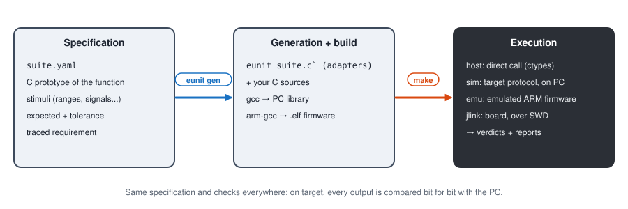

# e2Unit tutorials

**English** | [Français](../tutoriels/README.md)

Step by step guides to test C functions with e2Unit: describe the tests in a YAML file, run them on
the PC, then run **the same tests** on the microcontroller through a J-Link probe.



## Path

| # | Tutorial | Hardware | What you learn |
|---|---|---|---|
| 1 | [Getting started](01-getting-started.md) | PC | install, run the examples, read the results |
| 2 | [Testing a function](02-testing-a-function.md) | PC | write a suite, find a bug, fix it |
| 3 | [Stimuli and checks](03-stimuli-checks.md) | PC | sweeps, signals, tolerances, reference models |
| 4 | [Stateful functions](04-stateful-functions.md) | PC | context, hand-written adapter, setup and reset |
| 5 | [On target, without a board](05-target-without-board.md) | PC | ARM firmware, emulator, PC / target comparison |
| 6 | [On the FPB-RA4E1 board](06-ra4e1-jlink.md) | FPB-RA4E1 (J-Link OB) | flashing, running on the board, CPU cycles |
| 7 | [Integration](07-integration.md) | PC, board | global firmware, existing application, Jenkins |

Tutorials 1 to 4 need no hardware. Tutorial 5 already runs the real ARM binary, in an emulator.
Tutorial 6 moves to the board.

## Install e2Unit (once)

1. Get the e2Unit repository (Git clone or zip of the latest release).
2. Install **Python 3.10+**, then:

   ```
   pip install numpy pyyaml openpyxl matplotlib pyelftools pylink-square unicorn
   ```

   `openpyxl` is used by the Excel report, `matplotlib` by the plots, `pyelftools` and
   `pylink-square` by the J-Link probe, `unicorn` by the emulator. Only `numpy` and `pyyaml` are
   mandatory.
3. Install the build tools: **GNU make**, a **PC gcc** (for instance MSYS2, package
   `mingw-w64-ucrt-x86_64-gcc`) and **arm-none-eabi-gcc**. For the board: the **SEGGER J-Link** software.
4. Copy `eunit.local.mk.example` to `eunit.local.mk`, at the root of the repository, and set the
   tool paths:

   ```make
   PY         := C:/Dev/Tools/Python312/python.exe
   HOST_CC    := C:/Dev/Tools/msys64/ucrt64/bin/gcc.exe
   ARM_PREFIX := C:/Dev/Tools/arm-none-eabi-gcc-9 2020-q2-update/bin/arm-none-eabi-
   export PATH := C:/Dev/Tools/msys64/ucrt64/bin;$(PATH)
   ```

   This file belongs to the machine: it is not versioned.
5. The first time the tests run, a window asks how e2Unit will be used:

   | License | Use | Duration | How to get it |
   |---|---|---|---|
   | **Personal** | personal projects, study, research, teaching | perpetual | free, from the window |
   | **Demonstration** | evaluation at work | 1 month | free, from the window |
   | **Professional** | work, client projects | yearly subscription | key bought online, activated in the window |

   `python eunit_cli.py license` shows the current license; `license activate` enters a Professional
   key, `license deactivate` frees it for another computer. In continuous integration no window
   opens: the key is given by the `EUNIT_LICENSE_KEY` environment variable. The target runtime and
   the generated code are under the MIT license: they ship in your products without any e2Unit license.

## Choosing the runner

A **runner** executes the function calls. The specification and the checks are the same for all four.

| Runner | What runs | Command | What for |
|---|---|---|---|
| `host` | library built by the PC gcc | `make test` | developing the tests, CI |
| `sim` | same library, driven by the target protocol | `make test-sim` | validating the protocol without hardware |
| `emu` | ARM firmware (arm-gcc) in a Cortex-M emulator | `make test-emu` | validating the target code without a board |
| `jlink` | firmware on the board, through the SWD probe | `make test-target` | real result + CPU cycles |

On `emu` and `jlink`, every output is also **compared bit for bit** with the PC result: a compiler,
optimisation or type size difference is caught without writing any extra test.

## Examples used

| Folder | Content |
|---|---|
| [`examples/emath/src`](../../examples/emath/src) | fixed-point library: sine, Q15 multiplication, atan2, power, square root, sliding RMS |
| [`examples/emath/tests`](../../examples/emath/tests) | one suite per function (`sin/`, `mulq15/`...) and the global suite `all/` |
| [`examples/emath/tests/emath_ref.py`](../../examples/emath/tests/emath_ref.py) | Python reference models |
| [`boards/ra4e1`](../../boards/ra4e1) | RA4E1 board description (CPU options, memory, J-Link name) |

The console outputs and plots of these tutorials come from real runs of e2Unit 0.1.0.
