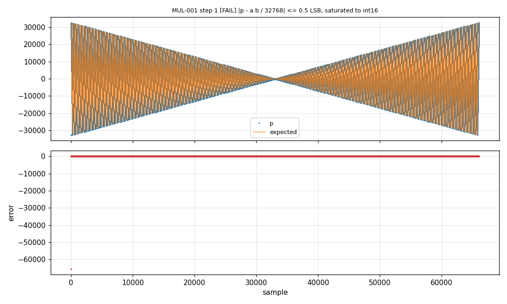

# 2. Tester une fonction

[English](../tutorials/02-testing-a-function.md) | **Français**

Écrire une suite pour une nouvelle fonction, voir e2Unit trouver un bug, le corriger. La fonction :
une multiplication en virgule fixe Q15, où 32767 vaut 1,0.

## 1. La fonction

Dans [`emath.h`](../../examples/emath/src/emath.h) :

```c
/* a * b in Q15, rounded to nearest, saturated: (-1) * (-1) = 32767 */
int16_t emath_mul_q15(int16_t a, int16_t b);
```

Première version, dans `emath_mul.c` :

```c
int16_t emath_mul_q15(int16_t a, int16_t b)
{
    return (int16_t)(((int32_t)a * b + (1 << 14)) >> 15);
}
```

Produit sur 32 bits, arrondi (+0,5 LSB), retour en Q15. Elle a l'air juste.

## 2. La suite

Créer `tests/mulq15/mulq15.yaml` :

```yaml
suite: mulq15

build:
  sources: [../../src/emath_mul.c]     # relatifs au fichier YAML
  includes: [../../src]
  headers: [emath.h]

functions:
  mul:
    prototype: "int16_t emath_mul_q15(int16_t a, int16_t b)"
    returns: p

tests:
  - id: MUL-001
    title: accuracy on a 257 x 257 grid
    requirement: EMATH-MUL-01
    call: mul
    combine: grid
    stimuli:
      a: {linspace: [-32768, 32767, 257]}
      b: {linspace: [-32768, 32767, 257]}
    checks:
      - desc: "|p - a b / 32768| <= 0.5 LSB, saturated to int16"
        expect: "sat(a * b / 32768, 'int16_t')"
        tolerance: {abs: 0.5}

  - id: MUL-002
    title: remarkable values
    requirement: EMATH-MUL-02
    call: mul
    stimuli:
      a: [16384, -16384, 32767, -32768, -32768, 0]
      b: [16384, 16384, 32767, 32767, -32768, -32768]
    checks:
      - desc: 0.5 x 0.5, -0.5 x 0.5, max x max, -1 x max, -1 x -1 (saturated), 0 x -1
        expect: [8192, -8192, 32766, -32767, 32767, 0]
```

Ligne par ligne :

- **`functions`** déclare la fonction par son **prototype C**. e2Unit en génère l'appel : rien à
  écrire en C pour les fonctions à paramètres scalaires. `returns: p` nomme la valeur de retour.
- **`stimuli`** donne les valeurs de chaque paramètre. `linspace` : 257 valeurs de -32768 à 32767.
  `combine: grid` croise toutes les valeurs de `a` avec toutes celles de `b` : 66 049 appels.
- **`expect`** est une expression Python (numpy) qui calcule la valeur attendue à partir des
  entrées. `sat(..., 'int16_t')` sature à la plage du type C. La **tolérance** de 0,5 LSB exprime
  l'exigence : le résultat est l'arrondi au plus proche.
- **MUL-002** donne les valeurs attendues explicitement : c'est la forme la plus lisible pour les
  cas remarquables.

Et le Makefile, comme pour toutes les suites :

```make
EUNIT_ROOT := ../../../..
SUITE      := mulq15.yaml
include $(EUNIT_ROOT)/mk/eunit.mk
```

## 3. Lancer

```
cd tests/mulq15
make EUNIT_RUN_OPTS="--plot build/plots"
```

```
e2Unit 0.1.0: suite mulq15, 2 test(s) on host
eunit: Personal License - Non-commercial use only
  [FAIL ] MUL-001 accuracy on a 257 x 257 grid (66049 samples, 0.01 s)
         1. [FAIL] |p - a b / 32768| <= 0.5 LSB, saturated to int16: 1/66049 samples out of tolerance (abs=0.5), max |err| 65535 at #0; first failure #0: a=-32768, b=-32768 -> p=-32768, expected 32767
  [FAIL ] MUL-002 remarkable values (6 samples, 0.00 s)
         1. [FAIL] 0.5 x 0.5, -0.5 x 0.5, max x max, -1 x max, -1 x -1 (saturated), 0 x -1: 1/6 samples out of tolerance (exact), max |err| 65535 at #4; first failure #4: a=-32768, b=-32768 -> p=-32768, expected 32767
eunit: 2 plot(s) in build/plots
eunit: FAIL - 0 passed, 2 failed, 0 errors, 0 skipped in 0.01 s - reports in build\report\host
```

Un seul cas faux sur 66 049, et le message le donne directement : **-1 × -1 donne -1**. Le produit
vaut +1,0, qui ne tient pas en Q15 (32768) et repasse en négatif lors de la conversion en `int16_t`.

Le graphe isole le point fautif :



## 4. Corriger

```c
int16_t emath_mul_q15(int16_t a, int16_t b)
{
    int32_t p = ((int32_t)a * b + (1 << 14)) >> 15;  /* rounded to nearest */
    if (p > 32767) {
        p = 32767;                                    /* only (-1) * (-1) */
    }
    return (int16_t)p;
}
```

`make` recompile ce qui a changé et relance :

```
  [PASS ] MUL-001 accuracy on a 257 x 257 grid (66049 samples, 0.01 s)
  [PASS ] MUL-002 remarkable values (6 samples, 0.00 s)
eunit: PASS - 2 passed, 0 failed, 0 errors, 0 skipped in 0.01 s - reports in build\report\host
```

## 5. Les garde-fous

e2Unit refuse les erreurs de spécification au lieu de les laisser passer.

**Prototype différent de l'en-tête.** Le prototype de la spécification est redéclaré dans le code
généré. Si le YAML indique `int32_t a` alors que `emath.h` dit `int16_t a`, la compilation échoue :

```
build/gen/eunit_suite.c:8:9: error: conflicting types for 'emath_mul_q15'; have 'int16_t(int32_t,  int16_t)'
...emath.h:17:9: note: previous declaration of 'emath_mul_q15' with type 'int16_t(int16_t,  int16_t)'
```

**Stimulus hors du type C.** Une valeur qui ne tient pas dans le paramètre (40000 pour un
`int16_t`) donne un test en **ERROR**, jamais une valeur tronquée en silence.

**Faute de frappe.** Une clé inconnue (`expected:` au lieu de `expect:`) est signalée avec la
liste des clés permises.

## Récapitulatif

| Étape | Fichier |
|---|---|
| fonction et en-tête | `src/emath_mul.c`, `src/emath.h` |
| spécification | `tests/mulq15/mulq15.yaml` |
| build et exécution | `tests/mulq15/Makefile` (3 lignes) |
| code généré | `tests/mulq15/build/gen/eunit_suite.c` (ne pas éditer) |

Le [tutoriel 3](03-stimuli-verifications.md) détaille toutes les formes de stimuli et de vérifications.
