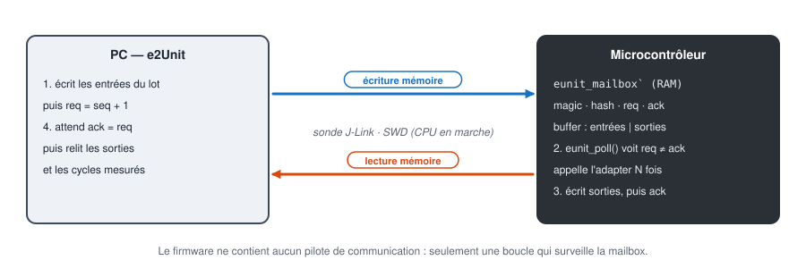

# 5. Sur cible, sans carte

[English](../tutorials/05-target-without-board.md) | **Français**

Compiler une suite pour le microcontrôleur, puis exécuter le **vrai binaire ARM** dans un émulateur
Cortex-M, comparé bit à bit au PC. Aucun matériel n'est nécessaire.

Tester sur PC ne suffit pas : la cible n'a pas le même compilateur, ni les mêmes options, ni
forcément la même taille de `int`. Un débordement, une division ou une extension de signe peuvent
donner un autre résultat. e2Unit exécute la même spécification sur les deux et compare.

## 1. Le firmware de test

```
cd examples/emath/tests/mulq15
make target
```

```
eunit: building build/ra4e1/mulq15.elf for ra4e1
   text	   data	    bss	    dec	    hex	filename
    972	      0	  32852	  33824	   8420	build/ra4e1/mulq15.elf
```

Le firmware contient :

| Élément | Fichier | Rôle |
|---|---|---|
| startup minimal | [`eunit_startup.c`](../../target/port/cortex-m/eunit_startup.c) | vecteurs, copie `.data`, FPU, capture des HardFault |
| runtime | [`eunit_runtime.c`](../../target/src/eunit_runtime.c) | exécution par lots, boucle de la mailbox |
| portage | [`eunit_port_cortexm.c`](../../target/port/cortex-m/eunit_port_cortexm.c) | compteur de cycles (DWT, ou SysTick sur M0/M23) |
| adapters | `build/gen/eunit_suite.c` | généré, le même que sur PC |
| votre code | `emath_mul.c` | compilé par arm-none-eabi-gcc |

Moins de 1 Ko de code. Les 32 Ko de `.bss` sont le buffer d'échange (8192 mots, réglable dans la
description de la carte). Pas d'interruption, pas de périphérique : le firmware tourne sur
l'horloge de reset.

La carte est décrite dans [`boards/ra4e1/board.mk`](../../boards/ra4e1/board.mk) :

```make
BOARD_CPU_FLAGS := -mcpu=cortex-m33 -mthumb -mfloat-abi=hard -mfpu=fpv5-sp-d16
BOARD_LDSCRIPT  := $(EUNIT_ROOT)/boards/ra4e1/ra4e1.ld
BOARD_DEFS      := -DEUNIT_BUF_WORDS=8192u -DEUNIT_CPU_HZ=0u
JLINK_DEVICE    := R7FA4E10D
BOARD_EMU_CPU   := cortex-m33
```

## 2. Le principe : une mailbox en RAM



Le firmware n'a aucun pilote de communication. Il réserve en RAM une structure, `eunit_mailbox`,
et la surveille en boucle :

1. le PC écrit les entrées d'un lot (des milliers d'appels) dans le buffer, puis incrémente `req` ;
2. le firmware voit `req ≠ ack`, appelle l'adapter pour chaque jeu d'entrées et mesure les cycles ;
3. il écrit les sorties, puis `ack = req` ;
4. le PC relit les sorties.

L'adresse de la mailbox est lue dans le `.elf`. Un **hash** de la spécification, compilé dans le
firmware, garantit que le binaire correspond aux tests : sinon, e2Unit refuse de lancer
(`rebuild it`).

## 3. Exécuter dans l'émulateur

```
make test-emu EUNIT_RUN_OPTS=-v
```

```
e2Unit 0.1.0: suite mulq15, 2 test(s) on emu (compared with host)
eunit: Personal License - Non-commercial use only
  [PASS ] MUL-001 accuracy on a 257 x 257 grid (66049 samples, 0.28 s)
         1. [PASS] |p - a b / 32768| <= 0.5 LSB, saturated to int16: 66049 samples, max |err| 0.5 (tol abs=0.5)
         2. [PASS] p identical to host: 66049 samples identical
  [PASS ] MUL-002 remarkable values (6 samples, 0.02 s)
         1. [PASS] 0.5 x 0.5, -0.5 x 0.5, max x max, -1 x max, -1 x -1 (saturated), 0 x -1: 6 samples, max |err| 0 (tol exact)
         2. [PASS] p identical to host: 6 samples identical
eunit: PASS - 2 passed, 0 failed, 0 errors, 0 skipped in 0.31 s - reports in build\report\emu-ra4e1
```

Le runner `emu` charge le `.elf` dans **Unicorn**, un émulateur de jeu d'instructions ARM, démarre
au vecteur de reset et dialogue avec la mailbox exactement comme le fera la sonde. Chaque test
reçoit une vérification de plus, **`p identical to host`** : la même suite est exécutée sur la
bibliothèque PC, et chaque sortie de la cible est comparée bit à bit.

L'émulateur exécute les instructions, mais ne compte pas les cycles : les vérifications `cycles`
restent SKIP.

## 4. Fautes et blocages

Sur la cible, une fonction peut planter ou ne jamais rendre la main. e2Unit le rapporte sur le test
concerné, puis réinitialise la cible pour la suite :

| Situation | Verdict | Message |
|---|---|---|
| accès mémoire invalide, HardFault | ERROR | `CPU fault at PC 0x...` |
| boucle infinie | ERROR | `no answer within ... s (function stuck in an infinite loop?)` |
| firmware absent ou arrêté | ERROR | `e2Unit runtime not ready (no magic at 0x...)` |

Sur la carte, l'adresse du PC fautif se retrouve dans le `.map` ou avec
`arm-none-eabi-addr2line -e build/ra4e1/<suite>.elf 0x...`.

## Un firmware par suite, ou un seul

Chaque suite produit son propre firmware : petit, rapide à flasher, isolé. La suite
[`tests/all`](../../examples/emath/tests/all/all.yaml) les regroupe en un seul :

```yaml
suite: emath_all
include:
  - ../sin/sin.yaml
  - ../mulq15/mulq15.yaml
  - ../atan2/atan2.yaml
  - ../pow/pow.yaml
  - ../isqrt/isqrt.yaml
  - ../rms/rms.yaml
```

Sources, fonctions et tests sont fusionnés : un seul flash pour les 18 tests. Le
[tutoriel 6](06-ra4e1-jlink.md) passe sur la carte.
