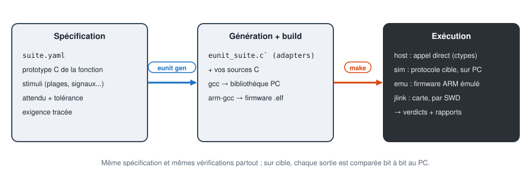

# Tutoriels e2Unit

[English](../tutorials/README.md) | **Français**

Pas à pas pour tester des fonctions C avec e2Unit : décrire les tests dans un fichier YAML, les
exécuter sur PC, puis exécuter **les mêmes tests** sur le microcontrôleur, par une sonde J-Link.



## Parcours

| # | Tutoriel | Matériel | Ce qu'on apprend |
|---|---|---|---|
| 1 | [Prise en main](01-prise-en-main.md) | PC | installer, lancer les exemples, lire les résultats |
| 2 | [Tester une fonction](02-tester-une-fonction.md) | PC | écrire une suite, trouver un bug, le corriger |
| 3 | [Stimuli et vérifications](03-stimuli-verifications.md) | PC | balayages, signaux, tolérances, modèles de référence |
| 4 | [Fonctions à état](04-fonctions-a-etat.md) | PC | contexte, adapter manuel, setup et reset |
| 5 | [Sur cible, sans carte](05-cible-sans-carte.md) | PC | firmware ARM, émulateur, comparaison PC / cible |
| 6 | [Sur carte FPB-RA4E1](06-ra4e1-jlink.md) | FPB-RA4E1 (J-Link OB) | flash, exécution sur carte, cycles CPU |
| 7 | [Intégration](07-integration.md) | PC, carte | firmware global, application existante, Jenkins |

Les tutoriels 1 à 4 ne demandent aucun matériel. Le 5 exécute déjà le vrai binaire ARM, dans un
émulateur. Le 6 passe sur la carte.

## Installer e2Unit (une fois)

1. Récupérer le dépôt e2Unit (clone Git ou zip de la dernière version).
2. Installer **Python 3.10+**, puis :

   ```
   pip install numpy pyyaml openpyxl matplotlib pyelftools pylink-square unicorn
   ```

   `openpyxl` sert au rapport Excel, `matplotlib` aux graphes, `pyelftools` et `pylink-square` à la
   sonde J-Link, `unicorn` à l'émulateur. Seuls `numpy` et `pyyaml` sont indispensables.
3. Installer les outils de build : **GNU make**, un **gcc PC** (par exemple MSYS2, paquet
   `mingw-w64-ucrt-x86_64-gcc`) et **arm-none-eabi-gcc**. Pour la carte : le logiciel **SEGGER J-Link**.
4. Copier `eunit.local.mk.example` en `eunit.local.mk`, à la racine du dépôt, et y indiquer les
   chemins des outils :

   ```make
   PY         := C:/Dev/Tools/Python312/python.exe
   HOST_CC    := C:/Dev/Tools/msys64/ucrt64/bin/gcc.exe
   ARM_PREFIX := C:/Dev/Tools/arm-none-eabi-gcc-9 2020-q2-update/bin/arm-none-eabi-
   export PATH := C:/Dev/Tools/msys64/ucrt64/bin;$(PATH)
   ```

   Ce fichier est propre au poste : il n'est pas versionné.
5. Au premier lancement des tests, une fenêtre demande comment e2Unit sera utilisé :

   | Licence | Usage | Durée | Obtention |
   |---|---|---|---|
   | **Personnelle** | projets personnels, études, recherche, enseignement | perpétuelle | gratuite, depuis la fenêtre |
   | **Démonstration** | essai en entreprise | 1 mois | gratuite, depuis la fenêtre |
   | **Professionnelle** | usage en entreprise, projets clients | abonnement annuel | clé achetée en ligne, activée dans la fenêtre |

   `python eunit_cli.py license` affiche la licence en cours ; `license activate` saisit une clé
   Professionnelle, `license deactivate` la libère pour un autre poste. En intégration continue,
   aucune fenêtre ne s'ouvre : la clé se donne par la variable d'environnement `EUNIT_LICENSE_KEY`.
   Le runtime embarqué et le code généré sont sous licence MIT : ils partent dans vos produits
   sans licence e2Unit.

## Choisir le runner

Un **runner** exécute les appels de fonction. La spécification et les vérifications sont les mêmes
pour les quatre.

| Runner | Ce qui tourne | Commande | Pour quoi faire |
|---|---|---|---|
| `host` | bibliothèque compilée par gcc PC | `make test` | développer les tests, CI |
| `sim` | même bibliothèque, pilotée par le protocole cible | `make test-sim` | valider le protocole sans matériel |
| `emu` | firmware ARM (arm-gcc) dans un émulateur Cortex-M | `make test-emu` | valider le code cible sans carte |
| `jlink` | firmware sur la carte, par la sonde SWD | `make test-target` | résultat réel + cycles CPU |

Sur `emu` et `jlink`, chaque sortie est aussi **comparée bit à bit** au résultat du PC : un écart
de compilateur, d'optimisation ou de taille de type est détecté sans écrire de test en plus.

## Exemples utilisés

| Dossier | Contenu |
|---|---|
| [`examples/emath/src`](../../examples/emath/src) | bibliothèque en virgule fixe : sin, multiplication Q15, atan2, puissance, racine, RMS glissant |
| [`examples/emath/tests`](../../examples/emath/tests) | une suite par fonction (`sin/`, `mulq15/`...) et la suite globale `all/` |
| [`examples/emath/tests/emath_ref.py`](../../examples/emath/tests/emath_ref.py) | modèles de référence en Python |
| [`boards/ra4e1`](../../boards/ra4e1) | description de la carte RA4E1 (options CPU, mémoire, nom J-Link) |

Les sorties console et les graphes de ces tutoriels viennent d'exécutions réelles d'e2Unit 0.1.0.
